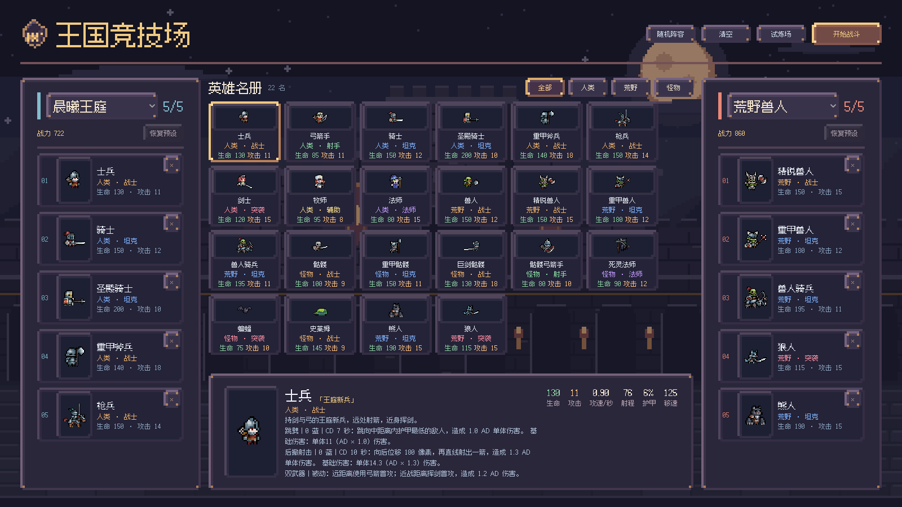
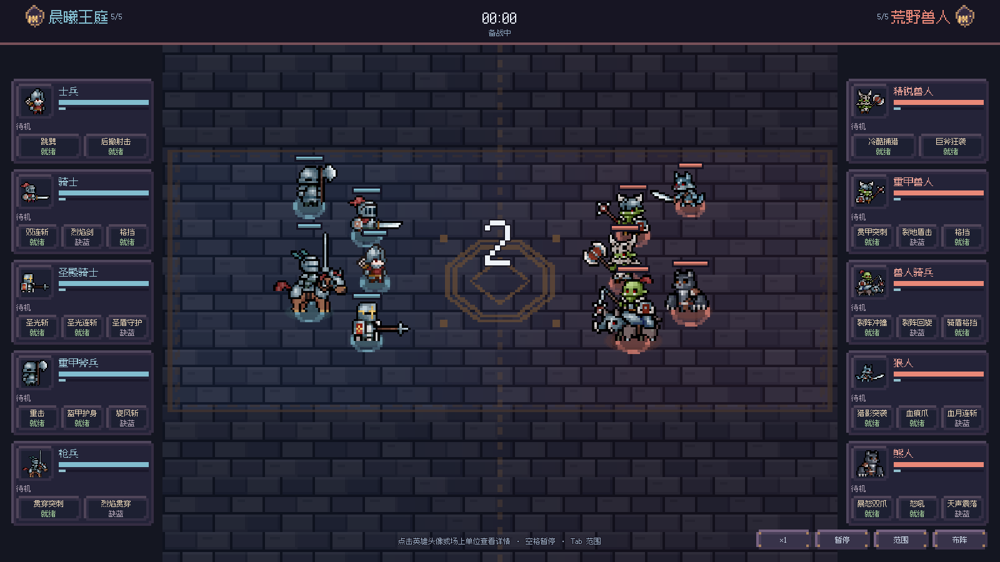
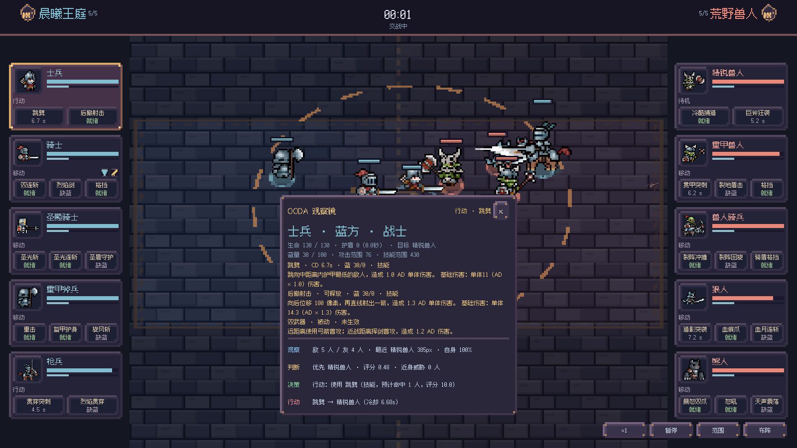
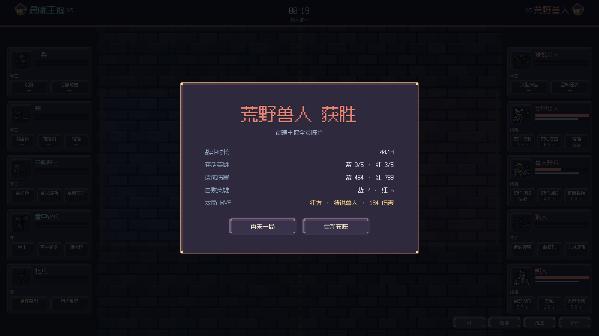
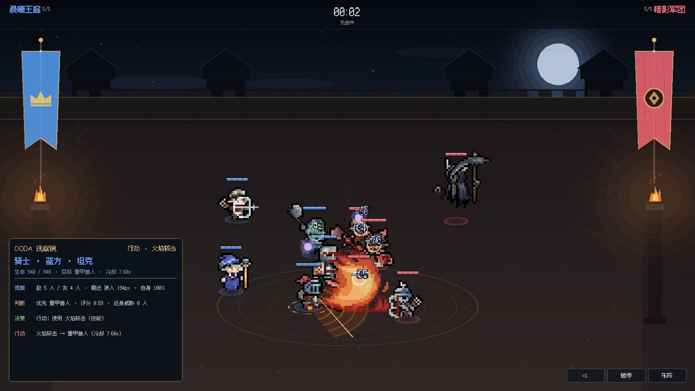
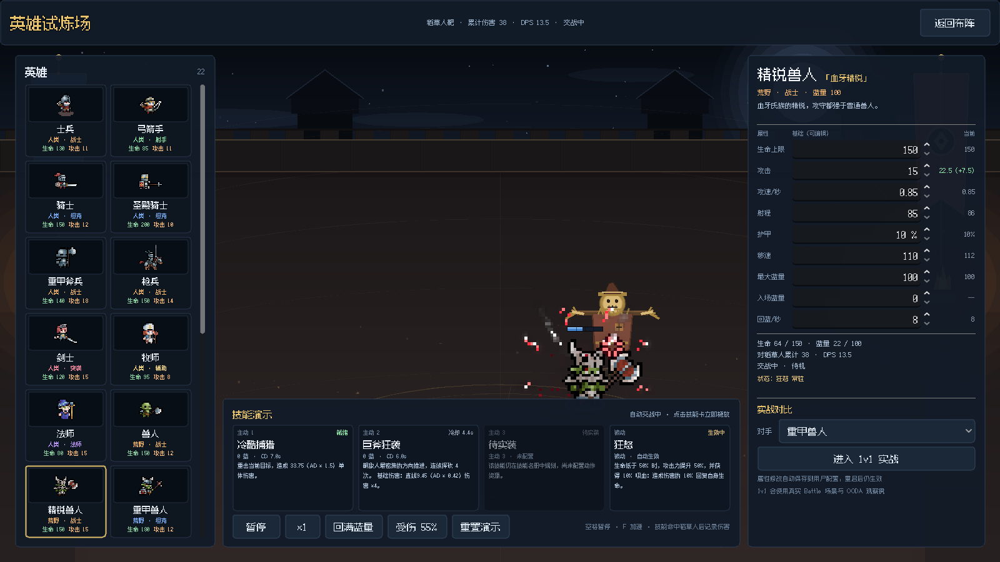
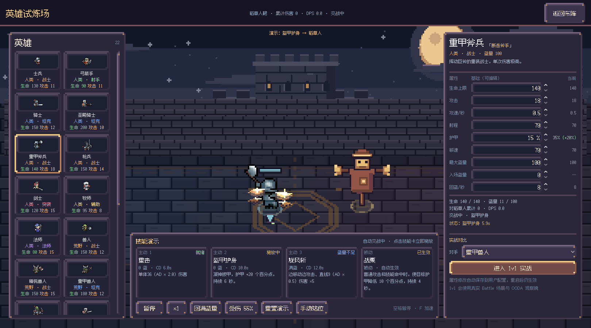
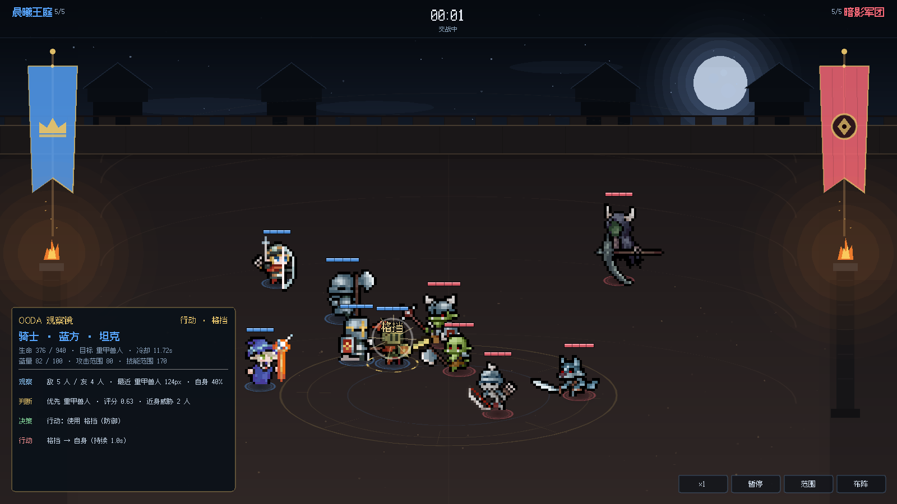
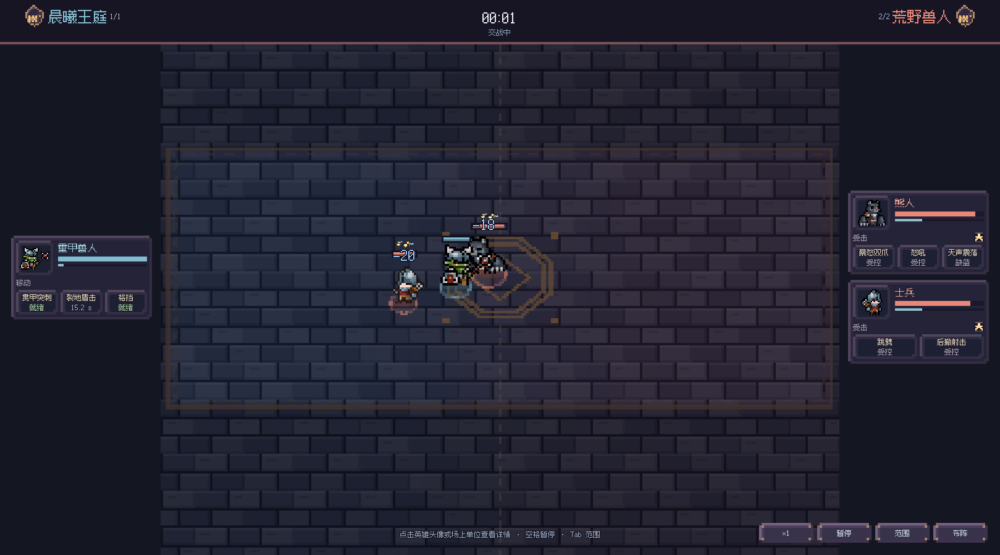
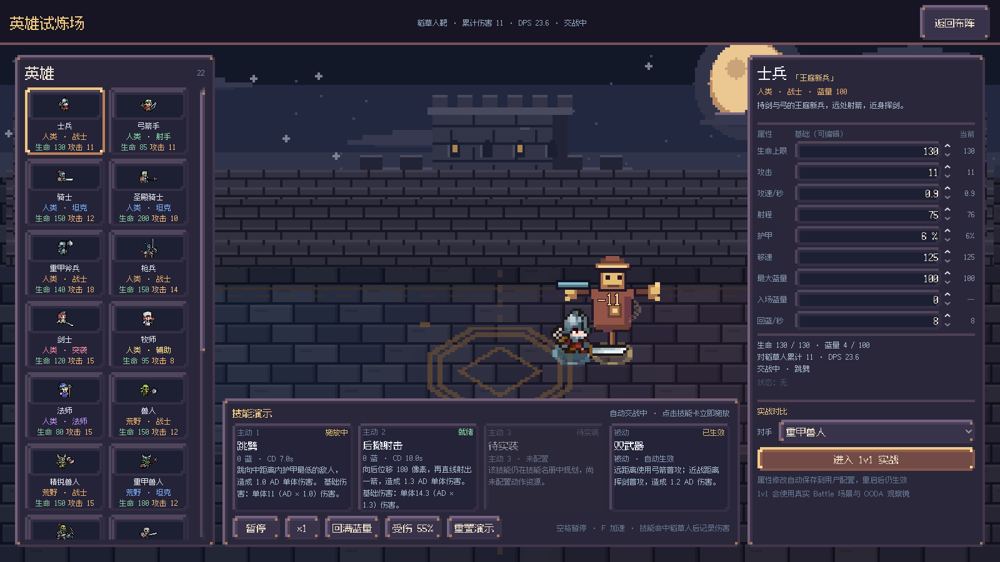

# 王国竞技场 · Kingdom Arena

> GitHub: https://github.com/Tifinity/kingdom-arena

一个基于 **Godot 4.6 / GDScript** 的 2D 自走棋演武 Demo：玩家配置双方各 5 名英雄，
倒计时结束后进入全自动战斗；一方英雄全部阵亡即判负。

它把“**场景负责结构、资源负责数据、代码负责动态逻辑**”作为实现原则：

- 22 名英雄全部来自 **Tiny RPG Character Asset Pack 01 v2.0**，每人都有待机、移动、攻击、受击、死亡动画。
- 单位、投射物、飘字、特效、HUD、名册卡片、布阵槽位、布阵界面、战斗界面都是独立的 `.tscn`。
- 英雄的数值、头像、SpriteFrames、攻击方式都是 `.tres` 资源；新增英雄不需要改战斗代码。
- 每个单位的 AI 用 **OODA（观察 → 判断 → 决策 → 行动）** 驱动，行为落地在节点化的 **有限状态机** 上。
- 战斗中可以点击任意单位，打开「OODA 观察镜」实时查看它的观察、判断、决策和行动。
- 提供独立的「英雄试炼场」：真实战斗对阵不会移动、不会死亡的稻草人，四技能槽可逐项演示，并同时显示基础属性与受 buff/debuff 影响的当前属性。
- **窗口分辨率自适应**：小窗自动切换紧凑界面，名册列数随宽度调整；非 16:9 窗口会扩展逻辑视口，背景铺满、战场边界重算。

| 布阵 | 对局 |
| --- | --- |
|  |  |
| **OODA 观察镜 / 投射物** | **结算** |
|  |  |

### 烈焰剑 · 统一 Action 系统



骑士使用 `attack_03` 的火焰帧释放 1.5 AD 扇形 AOE；技能与普攻共用同一个 `ActionState`，
由决策层在多个 `CombatActionDefinition` 中选出当前动作。

实际战斗默认不绘制范围环；点击右下角「范围」或按 `Tab` 打开选中单位的攻击/技能范围：
[范围调试对照](artifacts/flame_slash_ranges.png)。

### 圣殿骑士 · 金色剑气与圣盾

「圣光斩」挥出一道金色剑气，「圣光连斩」在上挑和下劈时各挥出一道剑气，第二斩结算扇形伤害。
满蓝大招「圣盾守护」冲向敌人最密集的可达位置，落地时展开由战场相机投影的正圆金色结界。
结界以实际嘲讽范围的 160px 为半径，骑士按命中人数获得护盾。数值见[技能追踪表](docs/SKILL_ROSTER.md)。

### 狂怒



精锐兽人的被动：生命低于 50% 时攻击力 +50%，并获得 10% 吸血（按实际造成的伤害回复生命）。
状态特效取自 pixelfx `status/seething`，导出时跳过替身身体，只保留怒纹、蒸汽与应激线；
生命回到阈值以上时，攻击加成、吸血和特效一起移除。重新导出见 `tools/export_rage_status.mjs`。

### 盔甲护身



重甲斧兵的防御技能：对自身提高 20 个百分点护甲，持续 6 秒。施放时铜甲片向身侧扣合，迸出短促火星；随后小甲片在腰间环绕，状态结束时消失。
特效使用 pixelfx 导出的前后两层序列帧，不替换角色材质。重新导出与截取见 [特效工作流](docs/VFX_WORKFLOW.md)。

### 格挡



骑士低血量时会优先使用格挡：播放 `block` 动画，获得 1 秒 `GUARD` 状态，
期间所有伤害归零、不进入受击硬直；成功挡住攻击后，格挡结束时获得最大生命 8% 的护盾，持续 3 秒。

重甲兽人的「格挡」改为举盾获得护盾：低血量时立即获得最大生命 20% 的护盾，持续 4 秒，
不再进入免伤状态。它的被动「铁颚再生」每秒回复 2% 最大生命。

### 眩晕



重甲兽人的满蓝大招「裂地盾击」会对自身圆形冲击波范围内**实际被命中**的敌人
追加 1 秒眩晕：目标立刻中断当前动作、强制进入受击状态，并在血条上方浮现三颗旋转的
金色星星；眩晕期间目标无法移动或行动，结束后自动回到待机。pixelfx 的 Stunned 序列帧由
`scenes/fx/stun_stars.tscn` 独立提供，法师冰封、熊人裂地等技能复用同一套
`STATUS` 效果与表现。其普通技能「贯甲突刺」是直线范围伤害与击退，并会无视目标的护盾，
不附带眩晕。

### 异常状态系统

五种异常状态由 `StatusDefinition` 数据 + `StatusBehavior` 行为策略驱动，统一管理叠加、Tick、
属性修正和 HUD 图标（图标当前使用 `assets/status/*.png` 占位，可直接替换同名文件）：

| 状态 | 效果 | 叠加规则 |
| --- | --- | --- |
| 眩晕 | 中断动作，禁止移动/行动，头顶三星 | 刷新 |
| 减速 | 降低移速 | 只取最强 |
| 流血 | 物理持续伤害，吃护甲 | 只取最强 |
| 燃烧 | 火焰持续伤害，无视护甲 | 只取最强 |
| 中毒 | 按最大生命值持续毒伤，无视护甲/护盾 | 叠 5 层，满层立即引爆剩余伤害 |

完整结构与扩展方式见 [异常状态系统](docs/STATUS_SYSTEM.md)。

## 运行

需要 **Godot 4.6+**（本机验证版本 `4.6.2.stable`）。

```sh
cd kingdom-arena
godot --path .
```

macOS 如果 `godot` 不在 PATH：
`/Applications/Godot.app/Contents/MacOS/Godot --path .`。

也可以用 Godot 编辑器打开 `project.godot` 后按 F5。游戏默认以独立窗口最大化启动，适配所在屏幕的可用区域，
还原后可自由缩放。以 `1600×900` 为基准，界面与战场通过 `viewport` + `expand` 缩放到窗口。场景铺地、铜纹边框和战斗标记以 4px 图元绘制，纹理使用最近邻采样。
非 16:9 窗口会扩展逻辑视口，背景铺满视口，战场边界与双方站位重新计算，布阵界面在扩展出的高度中垂直居中，
名册列数随可用宽度变化。窗口宽度低于 1500 或高度低于 850 个界面点时，布阵、实战和试炼场采用紧凑排版。
试炼场的技能栏移至底部，属性表可单独滚动，进入实战按钮留在右侧。缩放窗口时会即时重新排版。
战斗中途拖动窗口改变宽高比，单位也会被重新约束在新的战场范围内。录像使用固定录制布局。

## 玩法

1. **布阵**：把中间名册的英雄卡 **拖拽** 到左侧/右侧的任意槽位。
   - 拖拽时会出现英雄预览卡，槽位会显示金色高亮。
   - 已部署英雄可以从一个槽位拖到另一个槽位：目标为空则移动，目标已有英雄则交换。
   - 点击已部署槽位可查看该英雄详情；点 `×` 或右键移除。
   - 每侧 5 个槽位，槽位顺序即战场站位。双方可以混搭任意阵营的英雄。
   - 左右两侧的队名是独立下拉菜单。开局默认蓝方为「晨曦王庭」、红方为「荒野兽人」，两边都可以选择「暗夜亡灵」或互换阵营。
   - 选好队伍后仍可拖拽换人。切换队伍时保留该侧的编辑，点「恢复预设」可还原当前队伍的默认角色和顺序。
   - 晨曦王庭：士兵、骑士、圣殿骑士、重甲斧兵、枪兵。荒野兽人：精锐兽人、重甲兽人、兽人骑兵、狼人、熊人。暗夜亡灵：骷髅、重甲骷髅、巨剑骷髅、骷髅弓箭手、死灵法师。
   - 「随机阵容」生成双方各 5 名互不重复的随机英雄；「清空」清空两侧。
   - 顶部显示双方战力与人数，底部详情栏显示当前英雄的生命、攻击、攻速、射程、护甲、移速。
2. **开战**：点击右上角「开始战斗」。倒计时 3 秒后所有单位由 AI 接管。
3. **观战**：点击任意单位打开 OODA 观察镜；再次点击空白处关闭。
4. **结算**：任意一方全员阵亡后展示胜者、时长、存活人数、双方伤害/击败数与 MVP，
   可直接「再来一局」或返回「重新布阵」。

| 按键 | 作用 |
| --- | --- |
| 鼠标左键点单位 | 查看该单位的 OODA 决策 |
| `空格` | 暂停 / 继续 |
| `F` | 1× / 2× 变速 |
| `R` | 重开当前对局 |
| `Esc` | 返回布阵 |

右下角有「倍速 / 暂停 / 范围 / 音量 / 布阵」按钮。倍速依次循环 ×1 → ×2 → ×0.5 → ×1。「范围」或 `Tab` 开关选中单位的攻击和技能范围环，默认关闭。结算面板可以重赛或返回布阵。
战斗顶栏显示双方名称、剩余人数与计时。竞技场使用统一平面的大块石砖。

布阵页右上角和战斗界面右下角均可打开「音量」。背景音乐与技能音效分别调节，默认是 50% 和 60%，0% 为静音。关闭设置时保存音量，往后启动游戏和录制都沿用该设置。战斗开场播放《城门之下》，结算时淡出。

在布阵页切换「歼灭模式」和「攻坚模式」。歼灭以消灭敌方所有作战单位为目标。攻坚以摧毁敌方主基地为目标，基地自动发射箭矢，阵亡英雄在己方基地后方复活，首次等待 8 秒，每次再阵亡增加 3 秒，最多 20 秒。两种模式均以 5 分钟为上限，届时尚未达成胜利条件则判平。

切换到攻坚模式后，布阵页立即显示两座基地。可在 Godot 编辑器打开 `scenes/battle/battle.tscn`，调整 `BasePositions` 下的 `BlueBase` 和 `RedBase`。布阵与战斗共用这两个塔位。

### 保存并复跑对阵

布阵后点击「保存对阵」，导出 JSON。配置保存双方五个槽位（空槽为 `null`）、自定义站位、队伍预设编号、战斗模式、随机种子、试炼场属性覆盖、项目内容指纹和 Godot 构建版本。也可以从命令行生成一份默认阵容的配置。全新检出时先在 Godot 编辑器打开项目，或运行 `godot --headless --path . --import`。

```sh
# 可选，生成默认对阵。也可以用布阵界面保存的 JSON。
godot --headless --path . res://tools/replay_battle.tscn -- --create /tmp/arena-match.json

# 每次从同一份配置重新模拟。
godot --headless --path . --fixed-fps 60 res://tools/replay_battle.tscn -- --run /tmp/arena-match.json /tmp/arena-first.json
godot --headless --path . --fixed-fps 60 res://tools/replay_battle.tscn -- --run /tmp/arena-match.json /tmp/arena-second.json
cmp /tmp/arena-first.json /tmp/arena-second.json
```

复跑使用 1600×900 设计坐标和 60 Hz 物理步长。窗口尺寸只影响画面。出场事件位于第 0 帧，第一步战斗位于第 1 帧。结果 JSON 包含胜负（`0` 蓝方，`1` 红方，`-1` 平局或超时）、时长、统计，以及出场（包含召唤）、技能起手、伤害和阵亡序列。`source` 与 `target` 指向场内单位编号，对应出场事件中的 `target`。`tick / 60` 得到事件所属物理帧的秒数。

配置中的 `mode` 可设为 `elimination`（歼灭）或 `siege`（攻坚），字段缺省时为歼灭。可编辑英雄 ID、槽位和 `seed`，种子范围为 0 至 4294967295。复跑只应用配置中的属性覆盖。项目内容或 Godot 构建不匹配时会拒绝运行。5 分钟到时仍未分出胜负时，结果标记为 `timeout`，命令返回 2。去掉 `--headless` 可在窗口中观看复跑。

### 导出战斗视频

在 macOS 或 Linux 上从 Godot 工程运行游戏时，布阵页右上角点「导出录像」，选择 MP4 保存位置即可。当前阵容、站位、模式和音量用于录制，游戏会自动打开录制窗口并在导出结束后显示结果。首次使用前先完成 Godot 资源导入，并安装 FFmpeg。

也可以保存对阵 JSON 后运行以下命令，需要 Godot 4.6+、FFmpeg 和可用的图形环境。省略第二个参数时，视频会保存为与对阵 JSON 同目录、同名的 `.mp4`。

```sh
tools/export_battle_video.sh "/tmp/arena-match.json" "/tmp/arena-battle.mp4"
```

成片为原生 **1920×1080、60 fps、H.264 MP4**，沿用复跑的阵容与时间线，保留队名、计时、存活数、战场血条和结算。背景音乐与技能音效按本机最新保存的音量直接混进成片。录制会打开预览窗口，结算画面保留约 2 秒后自动转码。请保持窗口打开直到导出完成。

脚本会识别 PATH 中的 `godot`、`godot4` 或 macOS 的 Godot.app。可以通过 `GODOT_BIN`、`FFMPEG_BIN` 指定路径。导出会使用临时目录，并在成片就绪后写入目标路径。选择一个新文件名可以保留已有成片。

### 在编辑器里嵌入运行

Godot 的游戏嵌入功能需要项目使用 **Windowed** 模式。如需嵌入调试，可以在项目设置的
**Display → Window → Size → Mode** 中临时切换。Game 面板的尺寸菜单可选 **Stretch to Fit**，
让游戏画面随面板大小缩放。详见 [Godot 游戏嵌入文档](https://docs.godotengine.org/en/stable/tutorials/editor/game_embedding.html)。

## 调试单个英雄

### 当前逻辑：一个逻辑场景 + 每英雄视觉/行为配置

本项目 **没有为 22 个英雄各复制一份完整的 `unit.tscn`**。逻辑仍然共享，
但每个英雄现在都有自己的 **视觉子场景**，方便逐个拖拽精灵、血条和动画位置：

```text
scenes/battle/unit.tscn             共享逻辑：Brain / StateMachine / VisualHost
scenes/units/<id>_visual.tscn       每个英雄的视觉节点：
  ├─ Shadow
  ├─ TeamRing / SelectionRing
  ├─ Body (AnimatedSprite2D)        ← 拖这里调整动画位置/缩放
  ├─ HealthBar                      ← 拖这里调整血条位置
  ├─ Muzzle                         ← 拖这里调整投射物出手点
  └─ FootMarker / HitPoint

resources/units/<id>.tres           UnitDefinition（数值、Action、visual_scene…）
resources/visuals/<id>_frames.tres  SpriteFrames
resources/behaviors/<id>.tres       每个英雄的索敌/移动配置
```

战斗生成单位时执行：

```gdscript
var unit := UNIT_SCENE.instantiate()      # 共用 unit.tscn
unit.setup(battle, team, slot, definition) # 注入该英雄的数据资源
```

这样做的好处：

- 22 个英雄共享 Brain/FSM/Action 执行逻辑，不会复制 22 份逻辑场景。
- 改一次血条/状态机/受击逻辑，22 个英雄同时生效。
- 新增英雄时生成 `.tres` + 视觉子场景 + behavior 配置，逻辑代码不变。
- 动画位置、血条、缩放放在视觉子场景；索敌/移动参数放在 behavior 资源。

如果某个英雄需要独有的**逻辑节点结构**（例如召唤物挂点、特殊碰撞盒），再为它创建
`unit.tscn` 的继承场景或自定义场景，并在单位生成处替换场景即可。
视觉差异已经通过 `visual_scene` 放在独立子场景里，不需要覆盖完整逻辑场景。

### 视觉动画位置怎么调

打开：

```text
scenes/units/knight_visual.tscn
scenes/units/archer_visual.tscn
scenes/units/armored_axeman_visual.tscn
...
```

在 2D 编辑器里直接调整：

- `Body` 的 `position`、`scale`、`offset`：精灵/动画位置；
- `HealthBar` 的 `position`：血条位置；
- `Shadow` 的 `position`/`scale`：影子；
- `Hurtbox` 的 `CollisionShape2D`：受击范围（圆形，红色调试轮廓）；
- `AttackBox` 的 `CollisionShape2D`：基础普攻范围（圆形，蓝色调试轮廓）；
- `FootMarker`、`HitPoint`：命中点/脚底锚点；
- `Muzzle`：投射物出手点。箭矢、法术弹从这里生成，朝左时自动镜像到身体另一侧。

`Hurtbox` / `AttackBox` 目前是**编辑器可视化和调试形状**：`monitoring = false`、
碰撞层为 0，不参与实际伤害结算。当前伤害仍由 Action 的距离/扇形/矩形数据判定。
`AttackBox` 表示基础普攻范围；技能范围请用战斗中选中单位后的「范围」按钮查看，
或编辑对应 `ActionEffectDefinition` 的 shape/length/width。

### 投射物出手点怎么调

打开对应英雄的视觉子场景（例如 `scenes/units/soldier_visual.tscn`），
选中 `Muzzle`（Marker2D），在 2D 视图里直接把它拖到弓/手上：

```text
scenes/units/soldier_visual.tscn
  └─ Muzzle   ← 选中后在 2D 视图拖动 position
```

- 坐标是**视觉场景像素**，和 `Body` 的 `position` 同一空间，不是 100×100 帧内坐标；
- 只需要按“朝右”摆一次，代码会按 `facing` 镜像水平坐标，朝左时自动换到另一侧；
- 普通射箭、后撤射击、法术弹共用这个点；飞行方向由 `projectile.gd` 在生成时重新瞄准目标；
- 没有 `Muzzle` 的视觉场景会回退到按 `body_radius` / `character_height` 推算的位置，
  所以新增英雄可以先生成场景、之后再补锚点；
- 首次生成（或批量补锚点）时，`position` 与旧公式算出的点完全一致，所以接入锚点不会让现有单位突然位移；之后可以随时在编辑器里拖拽。

`tools/build_assets.py` 只会在视觉场景**不存在**时生成它，**不会覆盖手工调整**。
需要重置某个英雄时，删除对应 `_visual.tscn` 后重新运行构建脚本即可。

### 技能数值在哪里调

打开 `resources/units/<英雄 id>.tres`，在 `actions` 中找到技能引用，再打开对应的
`resources/actions/<动作 id>.tres`。冷却、蓝耗、施放距离、AI 优先级在动作资源的
`[resource]` 中；伤害倍率、治疗量、状态持续时间和触发帧在该文件的 `effect_*`
子资源中；冲锋、闪现、推进的速度和距离在 `movement` 子资源中。

英雄基础攻击力、攻速、最大蓝量与回蓝速度在 `resources/units/<英雄 id>.tres`，
持续状态的叠层和默认持续时间在 `resources/status/<状态 id>.tres`。
字段、计算方式与完整修改示例见 [技能数值与架构说明](docs/SKILL_SYSTEM.md)。

现在 `tools/build_assets.py` 默认保留已有英雄和动作 `.tres`。只有显式使用
`--rebuild-actions` 或 `--rebuild-units` 才会覆盖对应手调数值。

### 索敌/移动怎么调

每个英雄一份：

```text
resources/behaviors/<id>.tres
```

里面有：

- `targeting`：索敌权重（距离、残血、威胁、后排、粘性）；
- `movement`：期望射程比例、侧向站位、推进比例、后撤阈值、后撤停止比例、侧向偏移。

同样，构建脚本只生成缺失文件，不会覆盖手工调整。共享逻辑在：

- `scripts/ai/behavior/weighted_targeting.gd`
- `scripts/ai/behavior/standard_movement.gd`

需要完全不同的逻辑时，新增一个 `TargetingStrategy` / `MovementStrategy` 小脚本资源，
在对应英雄的 behavior `.tres` 里替换即可，不需要复制 FSM 或完整单位场景。

### 用「英雄试炼场」调试

布阵页顶部点击 **试炼场**，或直接运行：

```sh
godot --path . res://scenes/debug/hero_lab.tscn
```



- 进入场景即生成真实 `unit.tscn` 英雄与一只不会移动、不会死亡、不会掉血的稻草人；
  英雄保留完整 Brain/FSM，会自动接近并攻击稻草人。
- 左侧：22 名英雄列表；切换英雄会重建双方单位。
- 底部：四个技能槽（3 个主动 + 1 个被动）。点击主动技能会补足蓝量和冷却、
  把英雄调整到有效距离，并立即向稻草人施放；技能槽实时显示就绪/冷却/蓝量不足/施放中。
  尚未实装的主动槽显示「待实装」，与 [技能名册](docs/SKILL_ROSTER.md) 的 3 主动 + 1 被动口径一致。
- 右侧：基础属性仍可编辑；每个属性额外显示「当前」值，buff/debuff 造成的差异用绿色/红色
  差值和状态列表（剩余时间、层数）标出。另有回满蓝量、受伤 50%、暂停、倍速与重置演示。
- 顶部与右侧实时显示对稻草人的累计伤害、DPS、当前动作与英雄生命/蓝量。
- 需要真实对局时，用右侧「进入 1v1 实战」切换到 `battle.tscn`（双方各 1 人），
  可继续用 OODA 观察镜检查索敌、判断、移动、攻击、受击、死亡的真实状态机行为。

稻草人定义在 `resources/training/training_dummy.tres`，视觉由
`scenes/units/scarecrow_visual.tscn` + `scripts/battle/scarecrow_body.gd` 绘制；
`UnitDefinition.training_dummy` 控制不移动、不死亡、不扣血。

## MVP 范围

| 已实现 | 说明 |
| --- | --- |
| 22 名英雄 | 名册、头像、属性、阵营、职业、详情 |
| 单英雄调试 | 英雄试炼场：真实战斗对阵稻草人、四技能逐项演示、基础/当前属性对照 |
| 可视化调参 | 每个英雄独立视觉子场景 + 独立索敌/移动 behavior 资源 |
| 双方布阵 | 5 槽位、替换、移除、随机、清空、战力统计 |
| 自动战斗 | 索敌、推进、走位分离、近战/远程普攻、投射物、受击、死亡、胜负 |
| OODA AI | 观察、评分判断、多 Action 选择、行动四段式；可暂停/变速观察 |
| 统一 Action | `actions` 列表 + `CombatActionDefinition` + `ActionEffectDefinition` + 单一 `ActionState` |
| 技能 | 22 名英雄均有普攻，除精锐兽人外均有满蓝大招；当前共接入 42 个主动技能和 4 个被动；目标为每人 3 主动 + 1 被动，设计与完成状态见 [docs/SKILL_ROSTER.md](docs/SKILL_ROSTER.md) |
| 战斗 HUD | 顶部双方名称/剩余人数/时间，无总血量；OODA 观察镜始终显示生命/蓝量/攻击范围/技能范围/冷却；暂停时仍可点击单位切换观察镜；选中单位的范围环由「范围」按钮或 `Tab` 开关，默认关闭；右下角控制按钮 |
| 竞技场 | 地面/背墙扩展至接近镜头高度，单位阵型纵向展开 |
| FSM | 待机、移动、行动、受击、死亡五个状态节点 |
| 表现 | 像素动画、血条、队伍光环、选中圈、飘字、挥砍弧光、箭矢/法术弹、粒子火花、三星眩晕、状态图标、结算面板、OODA 观察镜 |
| 分辨率自适应 | 窗口自由缩放；小窗自动调整界面；`viewport` + `expand` 保证背景与场地按逻辑视口铺满 |
| 自动化测试 | 无界面固定场景检查 + 8 场随机阵容压力测试 |

**当前范围**：22 名英雄都有普攻，除精锐兽人（第三技能留空）外都有满蓝 100 的大招；部分单位已有额外普通技能；骑士、剑士、牧师、精锐兽人已接入被动。
普通攻击/普通技能只受 CD；
已经实现伤害、格挡、嘲讽、治疗、召唤、眩晕、减速、流血、燃烧、中毒和击退。装备、升级、经济与商店、羁绊、存档、音效、寻路避障暂不包含。
后续新效果继续用同一套 Action + Effect 扩展，不需要新增单位场景或状态机（见
[AI 设计文档](docs/AI_DESIGN.md) 与 [技能与行为扩展方案](docs/SKILLS_BEHAVIOR_PLAN.md)）。

## 架构

```text
project.godot
├─ autoload
│  ├─ UnitCatalog   扫描 resources/units/*.tres，排序后提供给名册
│  └─ GameState     保存双方 5 个槽位的英雄 id，跨场景传递
├─ scenes/setup/setup_screen.tscn      布阵界面（名册 + 双阵容 + 详情）
│  ├─ unit_card.tscn                   名册卡片
│  └─ lineup_panel.tscn                一侧阵容面板
│     └─ lineup_slot.tscn              单个槽位
├─ scenes/battle/battle.tscn           战斗场景
│  ├─ arena_background.tscn            天空 / 城堡 / 竞技场背墙 / 地面 / 法阵
│  ├─ UnitsRoot (Y-sort)               单位容器
│  ├─ Projectiles                     箭矢与法术弹
│  ├─ Effects                         挥砍、火花、飘字
│  └─ battle_hud.tscn                  紧凑顶栏、倒计时、OODA 观察镜、右下控制按钮、结算
├─ scenes/ui/control_button.tscn       半透明小控制按钮（战斗 3 个 + 布阵 4 个共用）
├─ scenes/battle/unit.tscn             单位逻辑场景（22 个英雄共用）
│  ├─ VisualHost                       每英雄视觉子场景挂点
│  ├─ Brain                            OODA 节点
│  └─ StateMachine
│     ├─ Idle / Move / Action / Hurt / Death
├─ scenes/units/<id>_visual.tscn       每个英雄的精灵/血条/影子/选中环
├─ resources/behaviors/<id>.tres       每个英雄的索敌/移动配置
├─ scenes/debug/hero_lab.tscn          英雄试炼场（单位 vs 稻草人、四技能演示）
├─ resources/training/training_dummy.tres 试炼稻草人（不移动、不死亡、记录伤害）
├─ scenes/units/scarecrow_visual.tscn  代码绘制的稻草人视觉
├─ resources/units/<id>.tres           UnitDefinition 数据
├─ resources/actions/<id>_basic.tres   每个英雄自动生成的基础普攻 Action
├─ resources/actions/knight_flame_slash.tres 骑士·火焰斩击 Action
├─ resources/visuals/<id>_frames.tres  SpriteFrames 动画
└─ assets/                             从素材包整理的贴图、头像、字体
```

### 场景与数据的职责

| 层 | 位置 | 职责 |
| --- | --- | --- |
| 场景结构 | `scenes/**/*.tscn` | 单位逻辑、每英雄视觉子场景、UI、特效、关卡布局和节点连接关系 |
| 静态数据 | `resources/units/*.tres`、`resources/visuals/*.tres`、`resources/behaviors/*.tres` | 数值、Action、动画帧、头像、索敌/移动参数 |
| 动态逻辑 | `scripts/**/*.gd` | 生成卡牌、结算伤害、OODA、FSM、行为策略、投射物、镜头外逻辑 |
| 跨场景数据 | `scripts/autoload/game_state.gd` | 双方槽位、上一局结算 |

`UnitDefinition` 通过 `@export` 字段描述一个英雄；运行时 `Unit.setup()` 只把资源挂到
共享逻辑场景与 `visual_scene` / `behavior_profile` 上，不包含任何具体英雄分支。
新增英雄 = 新增一个 `resources/units/<id>.tres` + 一份 `SpriteFrames` + 贴图与头像，
`UnitCatalog` 会在启动时自动扫描。

### 战斗数据流

```text
UnitCatalog ──> 布阵名册卡牌
       │             │ 点击卡片/槽位
       │             ▼
       └──────> GameState.lineups[team][slot]
                       │ 开始战斗
                       ▼
                Battle._spawn_lineups()
                       │
        ┌──────────────┼──────────────┐
        ▼              ▼              ▼
   UnitBrain       Unit FSM       Projectile / FX
   (每 0.16s)      (每物理帧)     
        │              │
        └── 目标/意图 ──> 状态执行：移动、普攻、受击、死亡
                                 │
                                 ▼
                     Battle 统计伤害/击杀 → 胜负 → HUD 结算
```

## OODA + 有限状态机

完整设计（评分公式、状态转换图、技能扩展点）见 [docs/AI_DESIGN.md](docs/AI_DESIGN.md)。

### OODA 四段

每个单位每 `0.16s` 思考一次（`UnitBrain`）：

| 阶段 | 代码 | 做什么 |
| --- | --- | --- |
| **O 观察** | `_observe()` | 收集存活敌人/友军、最近敌人、敌人数量、自身血量、平均距离；OODA 观察镜展示“敌 5 / 友 4 · 最近 重甲兽人 214px · 自身 100%” |
| **O 判断** | `_judge()` | 给每个敌人打分：距离、残血、输出威胁、职业克制、当前目标粘性；得到首选目标、评分与近身威胁数 |
| **D 决策** | `_decide()` | 产出意图：待机 / 推进 / 攻击 / 拉开距离（KITE）；远程被贴脸且冷却中时会后撤 |
| **A 行动** | `_act()` | 把目标与意图写给 `Unit`；由状态机当前状态节点执行移动/动画/伤害/投射物 |

判断评分（`UnitBrain._score_target`）：

```text
score = 距离权重 0.50 × (1 - clamp(距离 / 1000))
      + 残血权重 0.25 × (1 - 目标生命比例)
      + 威胁权重 0.12 × clamp(目标 DPS / 140)
      + 突袭职业对远程目标 +0.18
      + 远程职业对坦克目标 -0.08
      + 当前目标粘性 +0.08
      + 少量随机扰动
```

### FSM 五状态

| 状态 | 节点脚本 | 行为 |
| --- | --- | --- |
| **待机** `idle` | `scripts/ai/states/idle_state.gd` | 播放 idle、面向目标，读取 Brain 的行动计划 |
| **移动** `move` | `move_state.gd` | 走向目标周围的个人战斗位（按槽位错开 Y 轴）；远程被贴脸时后撤 |
| **行动** `action` | `action_state.gd` | 执行选中的 `CombatActionDefinition`：动画、命中帧、伤害/投射物/AOE、冷却；普攻与技能共用 |
| **受击** `hurt` | `hurt_state.gd` | 眩晕等控制效果打断当前动作；普通伤害只播放闪烁，不切换状态 |
| **死亡** `death` | `death_state.gd` | 播放死亡动画，尸体停留后淡出并释放，通知 Battle 判定胜负 |

状态由 `UnitStateMachine` 统一切换，状态节点是 `unit.tscn` 里真实存在的子节点，可以单独在
编辑器里看到和调整。`Unit.take_damage()` 不会切到 `hurt`；眩晕由控制状态明确打断动作，
避免普通伤害在 5v5 混战里反复中断施法。

### 为什么用“目标周围的战斗位”

如果所有单位都朝目标坐标移动，10 个单位会在同一个点重叠。`Unit.desired_combat_position()`
让每个槽位在目标周围占据不同的侧向位置：

```text
       蓝方(team 0)                     红方(team 1)
   slot0  ●  ─┐                    ┌─  ●  slot0
   slot1  ●   ├──> 目标(x,y) <──┤   ●  slot1
   slot2  ●  ─┘                    └─  ●  slot2
```

再加上每帧的软分离（`Battle._resolve_separation()`），混战会形成可读的包围圈，而不是
一坨叠在一起的精灵。血条、近战弧光和投射物也因此更容易看清。

### 统一 Action 系统（已接入）

角色不再只有“一个普攻 + 一个技能”，而是持有 `actions: Array[CombatActionDefinition]`：

```text
UnitBrain._decide()
    观察 → 判断目标 → 遍历 actions
    → 过滤冷却/距离/资源
    → 选出 ActionPlan(action, target)
                    ↓
UnitActionState（唯一行动状态）
    → 播放 action.animation
    → 按 trigger_frame 执行 effects
    → 单个/扇形/圆形伤害、投射物、视觉
                    ↓
回到 Idle，等待下一次决策
```

当前已经落地：

- `CombatActionDefinition`：动作 ID、名称、分类、目标类型、动画、范围、冷却、优先级、效果列表；
- `ActionEffectDefinition`：伤害、投射物、视觉等效果类型，支持命中帧/形状/半径/半角/倍率；
- `UnitActionState`：普攻和技能共用的统一行动状态；
- `UnitBrain._select_action()`：从多个 Action 中按优先级、AOE 数量、防御紧迫度选动作；
- 骑士 `knight_flame_slash`（烈焰剑）：`attack_03` 火焰动画，第 7 帧触发 170px / ±65° 扇形 1.5 AD AOE；
- 22 名英雄的技能设计与完成状态：`docs/SKILL_ROSTER.md`；
- 所有扇形/矩形技能的 `action_range` 与实际伤害形状半径/长度完全一致；选择距离额外保留 12% 施法缓冲，扇形朝向使用完整 2D 方向；
- 每个英雄自动生成 `basic_attack`，并按动画资源配置普通技能/大招；
- 普通技能 `mana_cost = 0`，只受 CD；大招 `mana_cost = 100`，释放后清空蓝量；
- 已有 `block` / `heal` / `summon` 动画的英雄会分别接入格挡、治疗、召唤；
- 普攻、技能、投射物和持续伤害都不会仅凭伤害打断动作；眩晕仍会打断，技能配置的击退仍会位移；
- Hero Lab 右侧可直接调整生命上限、攻击、攻速、射程、护甲、移速、最大蓝量、入场蓝量与回蓝；基础值列旁会显示包含 buff/debuff 的当前值，修改会自动保存到 `user://hero_stat_overrides.cfg`，重启游戏后仍生效；战斗内按 `F2` 可调整当前选中单位并立即生效；
- 效果类型覆盖：`DAMAGE`（单体/扇形/矩形/圆形）、`PROJECTILE`、`GUARD`、`SHIELD`（固定比例或按命中人数）、`HEAL`、`SUMMON`、`STATUS`（眩晕/减速/流血/燃烧/中毒）、`DISPLACE`（击退）；伤害效果可用 `ignore_shield` 穿透护盾。

### 多个 Action 同时可用时怎么选

决策层不是按“技能优先/普攻优先”写死，而是先过滤、再评分：

1. **硬过滤**：存活、动作冷却、蓝量、目标类型、施法距离、血量条件；
2. **评分**：
   - 基础分：`action.priority`；
   - 伤害 AOE：`+ 1.5 × 扇形/圆形内敌人数`；
   - 定向矩形：`+ 2 × 矩形内敌人数`；
   - 防御动作：`+ (1 - 当前生命比例) × 25`；
3. **取最高分**；同分时比较 `priority`，再同分则保留 `actions` 数组顺序；
4. **行动锁**：一次只提交一个 `ActionPlan`，ActionState 执行期间 Brain 不再改写计划。

以骑士和重甲斧兵为例：

```text
火焰斩击：priority 10 + AOE 敌人数 × 1.5
格挡：    priority 6  + 缺失生命比例 × 25（生命 ≤ 55% 才候选）
旋风斩：  priority 9  + 矩形内敌人数 × 2
重击：    priority 8
盔甲护身：priority 5（自身护甲 +20 个百分点，持续 6 秒）
普攻：    priority 0，兜底
```

所以满血时格挡不参与，火焰斩击/普攻竞争；半血以下两者都可用时，
格挡的防御紧迫度会超过火焰斩击，优先保命。旋风斩不再要求“至少 2 名敌人”，
只要矩形内至少有一名敌人且蓝量满，就能参与评分；它命中 1 人时仍比基础重击分高，
所以单目标也会优先旋风斩，重击在旋风斩冷却或蓝量不足时作为无蓝耗单体选择。
格挡结束后，火焰斩击仍然保留。

后续扩展方向：

- `HEAL / SHIELD / STATUS / DISPLACE / SUMMON` 效果类型；
- 护盾、位移、连续攻击继续复用 `ActionState`；
- 更复杂的目标策略再引入 `BehaviorProfile` / `ActionRule` / 自定义 ActionLogic。

完整架构与扩展计划见
[技能与行为扩展方案](docs/SKILLS_BEHAVIOR_PLAN.md)。

## 从技能实验室导入

在技能实验室从「竞技场 · 箭雨」或巨剑骷髅的四项技能范例开始，修改节点参数后点击「导出到竞技场」。在王国竞技场项目根目录执行：

```sh
godot --headless --path . res://tools/import_arena_skill.tscn -- ~/Downloads/archer_arrow_rain.arena-skill.json
```

如果 macOS 上没有 `godot` 命令，用 `/Applications/Godot.app/Contents/MacOS/Godot` 替换。第一次操作新检出的项目时，先在 Godot 编辑器打开项目，让素材完成导入。

主动技能的名称、冷却、蓝耗、射程、伤害范围及 AD 倍率取自 JSON。箭雨的半径同时用于选点、伤害和特效，斩首可修改生命阈值与增伤比例。游戏绑定负责角色动作、命中帧、特效和音效。导入后重启游戏，在英雄试炼场选择对应角色验证。

## 测试

无界面冒烟测试：

```sh
godot --headless --path . res://tests/test_runner.tscn
```

覆盖：

- 22 份英雄资源、头像、五类必需动画存在；
- 布阵场景生成 22 张卡牌、双方各 5 个槽位；
- 部署/移除/筛选的真实信号链路；
- 英雄试炼场生成 22 张英雄卡、真实 Battle、英雄与稻草人、四个技能槽；稻草人免疫致命伤害且不会被移动；
- 点击技能卡会真实施放技能并进入冷却；切换英雄会重建训练单位；基础/当前属性列能显示被动增益与减速；
- 默认阵容与随机阵容各打一场完整战斗；
- 败方全员阵亡、FSM 确实进入过行动/移动/死亡；眩晕场景单独验证受击状态；
- 双方都造成过伤害、远程单位确实发射过投射物；
- OODA 快照的观察、判断、决策、行动文本已更新；
- 骑士火焰斩击 Action 数据、决策层选择、扇形内多人掉血、身后敌人不受影响；
- 每个英雄至少有一个满蓝大招，普通技能不消耗蓝；
- 所有现有 attack02/03 动画都被某个技能使用；
- 治疗、召唤、眩晕、击退实际生效；
- 眩晕会打断当前动作、强制进入受击状态并保持到眩晕结束，头顶三星特效显示/旋转/结束；
- 重甲兽人裂地盾击眩晕所有被命中的敌人；贯甲突刺只造成直线伤害与击退且无视护盾；格挡改为获得 20% 最大生命护盾；被动每秒回复 2% 最大生命；
- 状态目录、叠加规则（眩晕刷新、流血/燃烧/减速取最强、中毒叠层爆发）与状态图标显示；
- 格挡、旋风斩、重击、火焰斩击等既有行为保持；
- 冷却中的旧 Action 不会被 Idle 重复进入，技能冷却后恢复普攻。

随机阵容压力测试（8 场，验证不卡死）：

```sh
godot --headless --path . res://tools/soak_test.tscn
```

本机最近一轮结果：8 场全部结束（示例轮次：蓝 6 / 红 2 / 平 0，平均 27.2 秒）。

重新生成截图：

```sh
godot --path . res://tools/capture.tscn --resolution 1600x900
# 单独抓取骑士火焰斩击的火焰帧
godot --path . res://tools/flame_capture.tscn --resolution 1600x900
# 抓取骑士格挡的格挡帧
godot --path . res://tools/block_capture.tscn --resolution 1600x900
```

## 素材

> Tiny RPG 角色素材由项目作者提供；作者确认该素材包为本人于 itch.io 购买的授权素材，
> 并同意用于本项目及其公开仓库。源目录未附许可文件，具体授权范围以 itch.io 购买记录
> 和原作者条款为准；请保留购买凭证，不要把完整素材包作为独立资源再分发。
> 字体为 SIL OFL 1.1，详见 [ASSET_LICENSES.md](ASSET_LICENSES.md)。

- 角色动画、箭矢、法术效果来自用户提供的
  `~/Downloads/Tiny RPG Character Asset Pack 01 v2.0 -Full 22 Characters/`。
- 头像由待机动画首帧自动裁切生成；法术球、阴影、像素点由脚本生成。
- UI 字体为 **Fusion Pixel 12px**（SIL OFL 1.1），许可证随字体放在 `assets/fonts/`。

## 已知限制

- 22 名英雄已拥有主动技能；法力仅实现基础蓝池、回复与满蓝大招，尚无装备、打断、驱散等系统。
- 没有寻路与障碍物，单位做直线移动 + 软分离；竞技场是一整块平地。
- 投射物追踪目标，目标死亡后会继续飞行一小段再消失。
- 数值为 Demo 级粗调，双方可自由混搭英雄，不保证绝对平衡。
- 布阵/战斗只支持 5v5，不支持中途换人。

## 参考

- 同机的《波比竞技场》《部落大战》的“数据资源 + 场景拆分 + HUD 分层 + 无界面测试”组织方式。
- Godot 官方文档推荐的节点/场景结构、`AnimatedSprite2D` + `SpriteFrames`、`@export` 资源、
  `Tween` 与 `SceneTreeTimer`、`process_mode` 暂停处理、Y-sort 绘制顺序。
