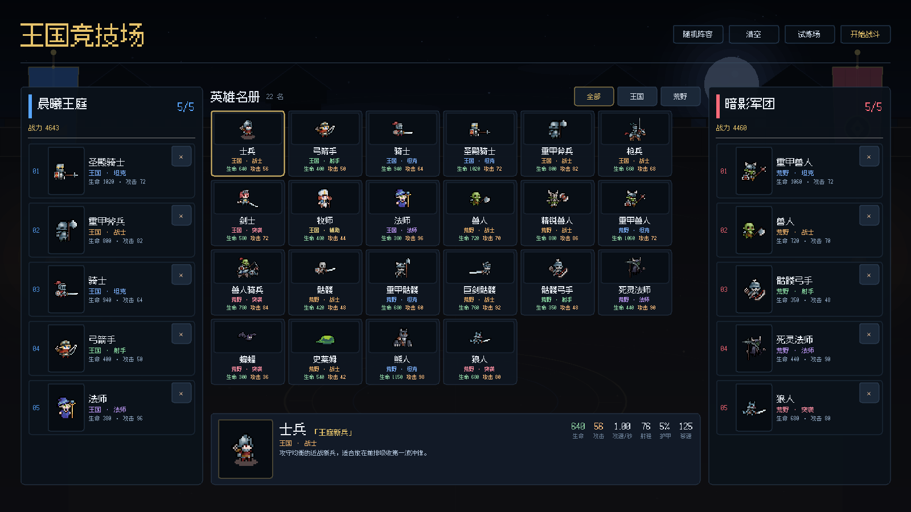
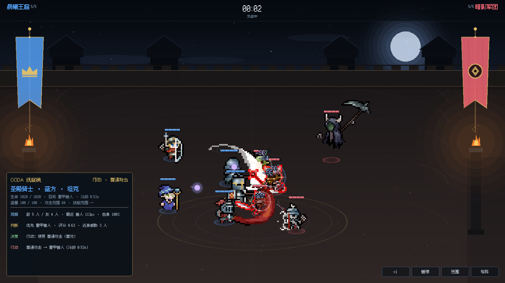
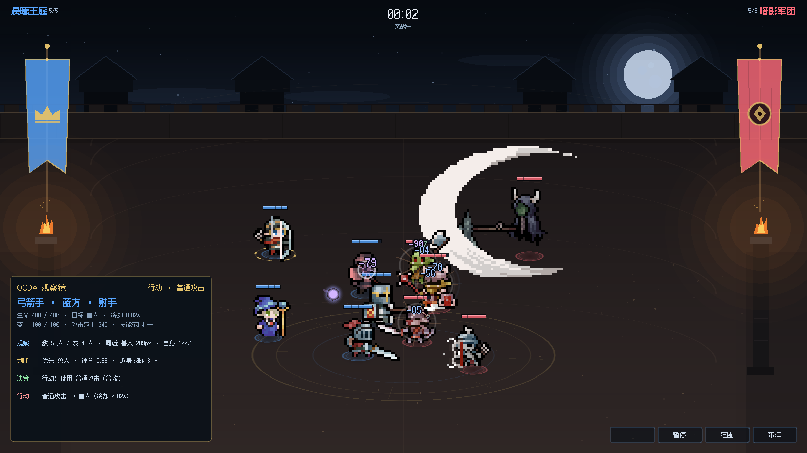
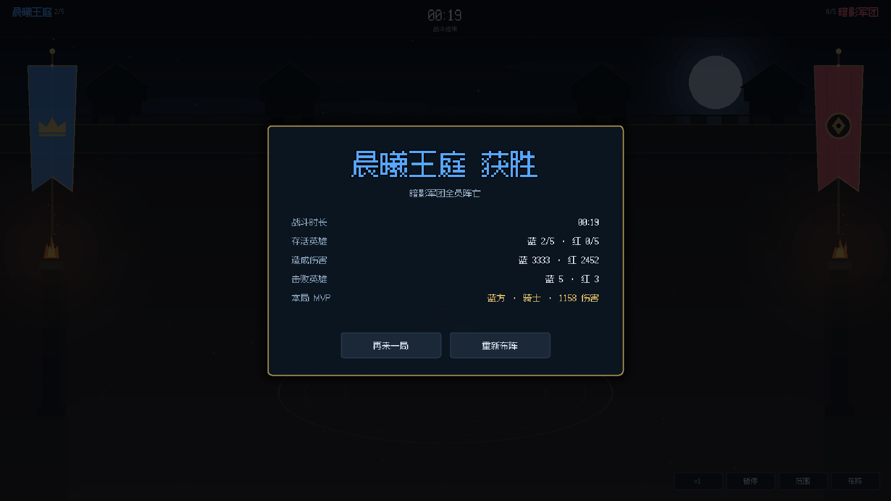
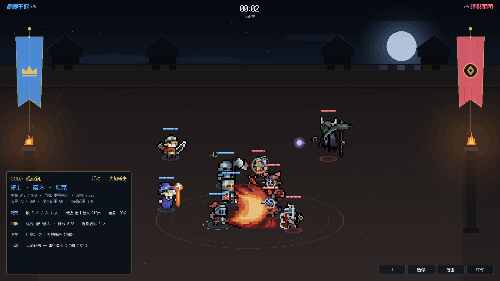
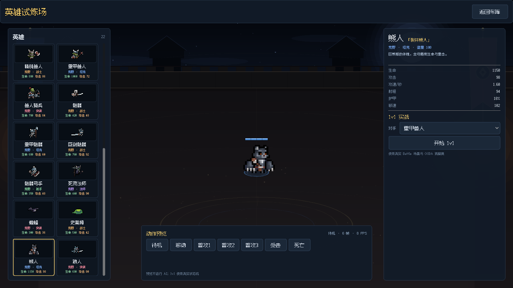

# 王国竞技场 · Kingdom Arena

> GitHub: https://github.com/Tifinity/kingdom-arena

一个基于 **Godot 4.6 / GDScript** 的 2D 自走棋演武 Demo：玩家配置双方各 5 名英雄，
倒计时结束后进入全自动战斗；一方英雄全部阵亡即判负。

它把“**场景负责结构、资源负责数据、代码负责动态逻辑**”作为实现原则：

- 22 名英雄全部来自 **Tiny RPG Character Asset Pack 01 v2.0**，每人都有待机、移动、攻击、受击、死亡动画。
- 单位、投射物、飘字、特效、HUD、名册卡片、布阵槽位、布阵界面、战斗界面都是独立的 `.tscn`。
- 英雄的数值、头像、SpriteFrames、攻击方式都是 `.tres` 资源；新增英雄不需要改战斗代码。
- 每个单位的 AI 用 **OODA（观察 → 判断 → 决策 → 行动）** 驱动，行为落地在节点化的 **有限状态机** 上。
- 战斗中可以点击任意单位，打开「OODA 观察镜」实时查看它的观察、判断、决策和行动。
- 提供独立的「英雄试炼场」：不运行 AI 手动预览任意英雄的全部动作，也可直接进入真实 1v1 战斗调试。
- **窗口分辨率自适应**：窗口可自由缩放；非 16:9 时逻辑视口自动扩展，背景铺满、战场边界重算，布阵内容垂直居中，名册列数随可用宽度调整。

| 布阵 | 对局 |
| --- | --- |
|  |  |
| **OODA 观察镜 / 投射物** | **结算** |
|  |  |

### 火焰斩击 · 统一 Action 系统



骑士使用 `attack_03` 的火焰帧释放扇形 AOE；技能与普攻共用同一个 `ActionState`，
由决策层在多个 `CombatActionDefinition` 中选出当前动作。

实际战斗默认不绘制范围环；点击右下角「范围」或按 `Tab` 打开选中单位的攻击/技能范围：
[范围调试对照](artifacts/flame_slash_ranges.png)。

## 运行

需要 **Godot 4.6+**（本机验证版本 `4.6.2.stable`）。

```sh
cd kingdom-arena
godot --path .
```

macOS 如果 `godot` 不在 PATH：
`/Applications/Godot.app/Contents/MacOS/Godot --path .`。

也可以用 Godot 编辑器打开 `project.godot` 后按 F5。逻辑基准分辨率为 `1600×900`，默认窗口 `1440×810`，
窗口可自由缩放，使用 `canvas_items` + `expand` 铺满窗口。非 16:9 窗口会扩展逻辑视口：
背景按视口比例铺满，战场边界与双方站位重新计算，布阵界面在扩展出的高度中垂直居中，
名册列数会在 6~12 列之间随可用宽度变化。
战斗中途拖动窗口改变大小，单位也会被重新约束在新的战场范围内。

## 玩法

1. **布阵**：把中间名册的英雄卡 **拖拽** 到左侧/右侧的任意槽位。
   - 拖拽时会出现英雄预览卡，槽位会显示金色高亮。
   - 已部署英雄可以从一个槽位拖到另一个槽位：目标为空则移动，目标已有英雄则交换。
   - 点击已部署槽位可查看该英雄详情；点 `×` 或右键移除。
   - 每侧 5 个槽位，槽位顺序即战场站位。双方可以混搭任意阵营的英雄。
   - 「随机阵容」生成双方各 5 名互不重复的随机英雄；「清空」清空两侧。
   - 顶部显示双方战力与人数，底部详情栏显示当前英雄的生命、攻击、攻速、射程、护甲、移速。
2. **开战**：点击右上角「开始战斗」。倒计时 3 秒后所有单位由 AI 接管。
3. **观战**：点击任意单位打开 OODA 观察镜；再次点击空白处关闭。
4. **结算**：任意一方全员阵亡后展示胜者、时长、存活人数、双方伤害/击败数与 MVP，
   可直接「再来一局」或返回「重新布阵」。

| 按键 | 作用 |
| --- | --- |
| 鼠标左键点单位 | 查看该单位的 OODA 决策 |
| `空格` | 暂停 / 继续 |
| `F` | 1× / 2× 变速 |
| `R` | 重开当前对局 |
| `Esc` | 返回布阵 |

右下角提供半透明「×1 / 暂停 / 范围 / 布阵」控制按钮（与布阵界面的四个按钮共用 `control_button.tscn`）；「范围」或 `Tab` 开关选中单位的攻击/技能范围环，默认关闭；结算面板有「再来一局 / 重新布阵」。
战斗顶栏只显示双方名称、剩余人数与计时，不显示总血量；竞技场地面抬高到接近全屏高度。

### 在编辑器里运行时没有跟着窗口放大？

这是 Godot 的 **Game Embedding（游戏嵌入）** 行为，不是项目的拉伸设置问题。
Game 嵌入默认使用 **Fixed Size**：启动参数里会带有 `--embedded --resolution 1440x810`，
所以无论怎么拖拽 Game 面板或编辑器窗口，游戏视口都会固定在 1440×810。

在 Godot 编辑器里解决：

1. 打开顶部 **Game** 主界面；
2. 点击 Game 栏右上角的尺寸下拉菜单；
3. 把 **Fixed Size** 改成 **Stretch to Fit**（或 **Keep Aspect Ratio**）；
4. 或者关闭嵌入：取消 **Embed Game on Next Play** / 选择 **Make Window Floating on Next Play**，
   再运行就会得到独立、可自由缩放的调试窗口。

也可以直接在终端运行，打开的就是普通独立窗口：

```sh
godot --path .
```

Godot 文档：[Game embedding](https://docs.godotengine.org/en/stable/tutorials/editor/game_embedding.html)
（见 “Embedded window sizing” 一节）。注意嵌入模式本身不支持全屏等窗口模式切换。

## 调试单个英雄

### 当前逻辑：一个单位场景 + 每个英雄一份资源

本项目 **没有为 22 个英雄各复制一份 `.tscn`**。所有英雄共用
[scenes/battle/unit.tscn](scenes/battle/unit.tscn)，差异全部放在资源里：

```text
unit.tscn                         每个英雄共享的节点结构
  ├─ Shadow / TeamRing / SelectionRing / Visual / HealthBar
  ├─ Brain                        OODA 决策
  └─ StateMachine                 Idle / Move / Action / Hurt / Death

resources/units/<id>.tres         每个英雄的 UnitDefinition（数值、攻击方式、头像、缩放…）
resources/visuals/<id>_frames.tres每个英雄的 SpriteFrames（idle/move/attack_01…）
```

战斗生成单位时执行：

```gdscript
var unit := UNIT_SCENE.instantiate()      # 共用 unit.tscn
unit.setup(battle, team, slot, definition) # 注入该英雄的数据资源
```

这样做的好处：

- 22 个英雄的节点结构、AI、状态机完全一致，不会复制 22 份场景与逻辑。
- 改一次血条/状态机/受击逻辑，22 个英雄同时生效。
- 新增英雄只需要新增 `.tres` + SpriteFrames，不改代码。
- 不同英雄的差异（动画、数值、近战/远程、投射物类型）都在数据层可查。

如果某个英雄需要独有的节点结构（例如召唤物挂点、特殊碰撞盒），再为它创建
`unit.tscn` 的继承场景或自定义场景，并在单位生成处替换场景即可；当前 MVP 没有这种需求。

### 用「英雄试炼场」调试

布阵页顶部点击 **试炼场**，或直接运行：

```sh
godot --path . res://scenes/debug/hero_lab.tscn
```



- 左侧：22 名英雄列表，点击切换预览对象。
- 中间：直接使用真实 `unit.tscn` + 当前英雄的 SpriteFrames/数值，所见即战斗中的表现。
- 底部：手动播放 `idle / move / attack_01 / attack_02 / attack_03 / hurt / death` 等全部动作；
  预览模式会关闭 Brain 与 StateMachine，避免动画被 AI 状态覆盖。
- 右侧：数值详情、对手选择与「开始 1v1」。
- 「开始 1v1」会进入真实 `battle.tscn`（双方各 1 人），可继续用 OODA 观察镜检查
  索敌、判断、移动、攻击、受击、死亡的真实状态机行为。

调试动画看试炼场的播放按钮；调试 AI/FSM 用试炼场的 1v1 或正常对局 + OODA 观察镜。

## MVP 范围

| 已实现 | 说明 |
| --- | --- |
| 22 名英雄 | 名册、头像、属性、阵营、职业、详情 |
| 单英雄调试 | 英雄试炼场：全部动作手动预览 + 真实 1v1 调试 |
| 双方布阵 | 5 槽位、替换、移除、随机、清空、战力统计 |
| 自动战斗 | 索敌、推进、走位分离、近战/远程普攻、投射物、受击、死亡、胜负 |
| OODA AI | 观察、评分判断、多 Action 选择、行动四段式；可暂停/变速观察 |
| 统一 Action | `actions` 列表 + `CombatActionDefinition` + `ActionEffectDefinition` + 单一 `ActionState` |
| 技能 | 骑士·火焰斩击：`attack_03` 火焰帧 + 170px/±65° 扇形 AOE + 8 秒冷却 + 30 蓝耗，单次只释放一次 |
| 战斗 HUD | 顶部双方名称/剩余人数/时间，无总血量；OODA 观察镜始终显示生命/蓝量/攻击范围/技能范围/冷却；选中单位的范围环由「范围」按钮或 `Tab` 开关，默认关闭；右下角控制按钮 |
| 竞技场 | 地面/背墙扩展至接近镜头高度，单位阵型纵向展开 |
| FSM | 待机、移动、行动、受击、死亡五个状态节点 |
| 表现 | 像素动画、血条、队伍光环、选中圈、飘字、挥砍弧光、箭矢/法术弹、粒子火花、结算面板、OODA 观察镜 |
| 分辨率自适应 | 窗口自由缩放；`canvas_items` + `expand`；背景/战场/站位按逻辑视口重算，布阵内容居中 |
| 自动化测试 | 108 项无界面检查 + 8 场随机阵容压力测试 |

**当前范围**：普攻 + 骑士火焰斩击。已经加入基础蓝量池（100）、每秒 8 点回复和技能蓝耗；
装备、升级、经济与商店、羁绊、存档、音效、寻路避障暂不包含。后续护盾/格挡/位移/连续攻击
继续用同一套 Action + Effect 扩展，不需要新增单位场景或状态机（见
[AI 设计文档](docs/AI_DESIGN.md) 与 [技能与行为扩展方案](docs/SKILLS_BEHAVIOR_PLAN.md)）。

## 架构

```text
project.godot
├─ autoload
│  ├─ UnitCatalog   扫描 resources/units/*.tres，排序后提供给名册
│  └─ GameState     保存双方 5 个槽位的英雄 id，跨场景传递
├─ scenes/setup/setup_screen.tscn      布阵界面（名册 + 双阵容 + 详情）
│  ├─ unit_card.tscn                   名册卡片
│  └─ lineup_panel.tscn                一侧阵容面板
│     └─ lineup_slot.tscn              单个槽位
├─ scenes/battle/battle.tscn           战斗场景
│  ├─ arena_background.tscn            天空 / 城堡 / 竞技场背墙 / 地面 / 法阵
│  ├─ UnitsRoot (Y-sort)               单位容器
│  ├─ Projectiles                     箭矢与法术弹
│  ├─ Effects                         挥砍、火花、飘字
│  └─ battle_hud.tscn                  紧凑顶栏、倒计时、OODA 观察镜、右下控制按钮、结算
├─ scenes/ui/control_button.tscn       半透明小控制按钮（战斗 3 个 + 布阵 4 个共用）
├─ scenes/battle/unit.tscn             单位场景（22 个英雄共用）
│  ├─ Shadow / TeamRing / SelectionRing / Visual / HealthBar
│  ├─ Brain                            OODA 节点
│  └─ StateMachine
│     ├─ Idle / Move / Action / Hurt / Death
├─ scenes/debug/hero_lab.tscn          英雄试炼场（单英雄动作预览 + 1v1）
├─ resources/units/<id>.tres           UnitDefinition 数据
├─ resources/actions/<id>_basic.tres   每个英雄自动生成的基础普攻 Action
├─ resources/actions/knight_flame_slash.tres 骑士·火焰斩击 Action
├─ resources/visuals/<id>_frames.tres  SpriteFrames 动画
└─ assets/                             从素材包整理的贴图、头像、字体
```

### 场景与数据的职责

| 层 | 位置 | 职责 |
| --- | --- | --- |
| 场景结构 | `scenes/**/*.tscn` | 单位、UI、特效、关卡布局和节点连接关系 |
| 静态数据 | `resources/units/*.tres`、`resources/visuals/*.tres` | 数值、攻击类型、动画帧、头像、缩放与脚底偏移 |
| 动态逻辑 | `scripts/**/*.gd` | 生成卡牌、结算伤害、OODA、FSM、投射物、镜头外逻辑 |
| 跨场景数据 | `scripts/autoload/game_state.gd` | 双方槽位、上一局结算 |

`UnitDefinition` 通过 `@export` 字段描述一个英雄；运行时 `Unit.setup()` 只把资源挂到
`unit.tscn` 的 `AnimatedSprite2D` / 血条 / 状态机上，不包含任何具体英雄分支。
新增英雄 = 新增一个 `resources/units/<id>.tres` + 一份 `SpriteFrames` + 贴图与头像，
`UnitCatalog` 会在启动时自动扫描。

### 战斗数据流

```text
UnitCatalog ──> 布阵名册卡牌
       │             │ 点击卡片/槽位
       │             ▼
       └──────> GameState.lineups[team][slot]
                       │ 开始战斗
                       ▼
                Battle._spawn_lineups()
                       │
        ┌──────────────┼──────────────┐
        ▼              ▼              ▼
   UnitBrain       Unit FSM       Projectile / FX
   (每 0.16s)      (每物理帧)     
        │              │
        └── 目标/意图 ──> 状态执行：移动、普攻、受击、死亡
                                 │
                                 ▼
                     Battle 统计伤害/击杀 → 胜负 → HUD 结算
```

## OODA + 有限状态机

完整设计（评分公式、状态转换图、技能扩展点）见 [docs/AI_DESIGN.md](docs/AI_DESIGN.md)。

### OODA 四段

每个单位每 `0.16s` 思考一次（`UnitBrain`）：

| 阶段 | 代码 | 做什么 |
| --- | --- | --- |
| **O 观察** | `_observe()` | 收集存活敌人/友军、最近敌人、敌人数量、自身血量、平均距离；OODA 观察镜展示“敌 5 / 友 4 · 最近 重甲兽人 214px · 自身 100%” |
| **O 判断** | `_judge()` | 给每个敌人打分：距离、残血、输出威胁、职业克制、当前目标粘性；得到首选目标、评分与近身威胁数 |
| **D 决策** | `_decide()` | 产出意图：待机 / 推进 / 攻击 / 拉开距离（KITE）；远程被贴脸且冷却中时会后撤 |
| **A 行动** | `_act()` | 把目标与意图写给 `Unit`；由状态机当前状态节点执行移动/动画/伤害/投射物 |

判断评分（`UnitBrain._score_target`）：

```text
score = 距离权重 0.50 × (1 - clamp(距离 / 1000))
      + 残血权重 0.25 × (1 - 目标生命比例)
      + 威胁权重 0.12 × clamp(目标 DPS / 140)
      + 突袭职业对远程目标 +0.18
      + 远程职业对坦克目标 -0.08
      + 当前目标粘性 +0.08
      + 少量随机扰动
```

### FSM 五状态

| 状态 | 节点脚本 | 行为 |
| --- | --- | --- |
| **待机** `idle` | `scripts/ai/states/idle_state.gd` | 播放 idle、面向目标，读取 Brain 的行动计划 |
| **移动** `move` | `move_state.gd` | 走向目标周围的个人战斗位（按槽位错开 Y 轴）；远程被贴脸时后撤 |
| **行动** `action` | `action_state.gd` | 执行选中的 `CombatActionDefinition`：动画、命中帧、伤害/投射物/AOE、冷却；普攻与技能共用 |
| **受击** `hurt` | `hurt_state.gd` | 被较大伤害打断当前动作，短暂僵直，然后恢复 |
| **死亡** `death` | `death_state.gd` | 播放死亡动画，尸体停留后淡出并释放，通知 Battle 判定胜负 |

状态由 `UnitStateMachine` 统一切换，状态节点是 `unit.tscn` 里真实存在的子节点，可以单独在
编辑器里看到和调整。`Unit.take_damage()` 只在“大伤害 + 受击冷却就绪”时强制切到 `hurt`，
避免 5v5 混战里被永久锁死。

### 为什么用“目标周围的战斗位”

如果所有单位都朝目标坐标移动，10 个单位会在同一个点重叠。`Unit.desired_combat_position()`
让每个槽位在目标周围占据不同的侧向位置：

```text
       蓝方(team 0)                     红方(team 1)
   slot0  ●  ─┐                    ┌─  ●  slot0
   slot1  ●   ├──> 目标(x,y) <──┤   ●  slot1
   slot2  ●  ─┘                    └─  ●  slot2
```

再加上每帧的软分离（`Battle._resolve_separation()`），混战会形成可读的包围圈，而不是
一坨叠在一起的精灵。血条、近战弧光和投射物也因此更容易看清。

### 统一 Action 系统（已接入）

角色不再只有“一个普攻 + 一个技能”，而是持有 `actions: Array[CombatActionDefinition]`：

```text
UnitBrain._decide()
    观察 → 判断目标 → 遍历 actions
    → 过滤冷却/距离/资源
    → 选出 ActionPlan(action, target)
                    ↓
UnitActionState（唯一行动状态）
    → 播放 action.animation
    → 按 trigger_frame 执行 effects
    → 单个/扇形/圆形伤害、投射物、视觉
                    ↓
回到 Idle，等待下一次决策
```

当前已经落地：

- `CombatActionDefinition`：动作 ID、名称、分类、目标类型、动画、范围、冷却、优先级、效果列表；
- `ActionEffectDefinition`：伤害、投射物、视觉等效果类型，支持命中帧/形状/半径/半角/倍率；
- `UnitActionState`：普攻和技能共用的统一行动状态；
- `UnitBrain._select_action()`：从多个 Action 中按优先级和 AOE 目标数量选动作；
- 骑士 `knight_flame_slash`：`attack_03` 火焰动画，第 7 帧触发 170px / ±65° 扇形 AOE；
- 每个单位自动生成 `basic_attack` Action；新增技能只需新增 Action 资源并加入 `actions`。

后续扩展方向：

- `HEAL / SHIELD / STATUS / DISPLACE / SUMMON` 效果类型；
- 护盾、格挡、突进、连续攻击继续复用 `ActionState`；
- 更复杂的目标策略再引入 `BehaviorProfile` / `ActionRule` / 自定义 ActionLogic。

完整架构与扩展计划见
[技能与行为扩展方案](docs/SKILLS_BEHAVIOR_PLAN.md)。

## 测试

无界面冒烟测试：

```sh
godot --headless --path . res://tests/test_runner.tscn
```

覆盖：

- 22 份英雄资源、头像、五类必需动画存在；
- 布阵场景生成 22 张卡牌、双方各 5 个槽位；
- 部署/移除/筛选的真实信号链路；
- 英雄试炼场生成 22 张英雄卡、预览单位、动作按钮，切换英雄与手动播放动画正常；
- 默认阵容与随机阵容各打一场完整战斗；
- 败方全员阵亡、FSM 确实进入过行动/受击/移动/死亡；
- 双方都造成过伤害、远程单位确实发射过投射物；
- OODA 快照的观察、判断、决策、行动文本已更新；
- 骑士火焰斩击 Action 数据、决策层选择、扇形内多人掉血、身后敌人不受影响；
- 一次技能只触发一次、蓝量消耗、蓝量不足回退普攻、调试快照含蓝量与攻击/技能范围；
- 范围环默认关闭、范围按钮可切换。

随机阵容压力测试（8 场，验证不卡死）：

```sh
godot --headless --path . res://tools/soak_test.tscn
```

本机最近一轮结果：8 场全部结束（示例轮次：蓝 6 / 红 2 / 平 0，平均 27.2 秒）。

重新生成截图：

```sh
godot --path . res://tools/capture.tscn --resolution 1600x900
# 单独抓取骑士火焰斩击的火焰帧
godot --path . res://tools/flame_capture.tscn --resolution 1600x900
```

## 素材

> Tiny RPG 角色素材由项目作者提供；作者确认该素材包为本人于 itch.io 购买的授权素材，
> 并同意用于本项目及其公开仓库。源目录未附许可文件，具体授权范围以 itch.io 购买记录
> 和原作者条款为准；请保留购买凭证，不要把完整素材包作为独立资源再分发。
> 字体为 SIL OFL 1.1，详见 [ASSET_LICENSES.md](ASSET_LICENSES.md)。

- 角色动画、箭矢、法术效果来自用户提供的
  `~/Downloads/Tiny RPG Character Asset Pack 01 v2.0 -Full 22 Characters/`。
- 头像由待机动画首帧自动裁切生成；法术球、阴影、像素点由脚本生成。
- UI 字体为 **Fusion Pixel 12px**（SIL OFL 1.1），许可证随字体放在 `assets/fonts/`。

## 已知限制

- 目前只有骑士一个主动技能（火焰斩击）；法力仅实现基础蓝池、回复与技能消耗，尚无装备、打断、驱散等系统。
- 没有寻路与障碍物，单位做直线移动 + 软分离；竞技场是一整块平地。
- 投射物追踪目标，目标死亡后会继续飞行一小段再消失。
- 数值为 Demo 级粗调，双方可自由混搭英雄，不保证绝对平衡。
- 没有音效/BGM；所有表现均为 2D 绘图或像素贴图。
- 布阵/战斗只支持 5v5，不支持中途换人。

## 参考

- 同机的《波比竞技场》《部落大战》的“数据资源 + 场景拆分 + HUD 分层 + 无界面测试”组织方式。
- Godot 官方文档推荐的节点/场景结构、`AnimatedSprite2D` + `SpriteFrames`、`@export` 资源、
  `Tween` 与 `SceneTreeTimer`、`process_mode` 暂停处理、Y-sort 绘制顺序。
