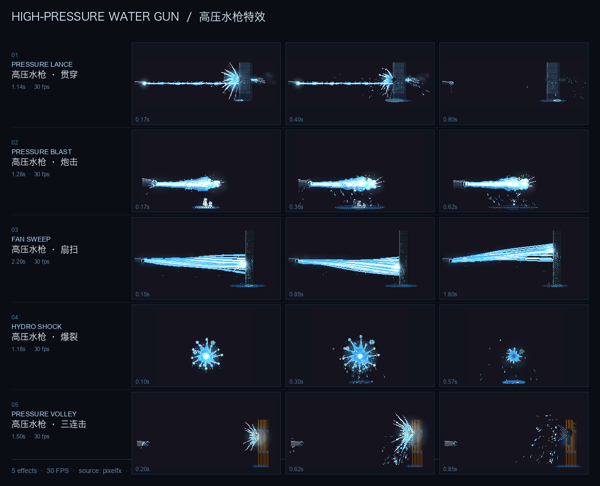

# 高压水枪特效 · High-pressure water gun

五套高压水枪像素特效，重点是“水被压力挤出去”的冲击感：白热的水芯、硬边的蓝色水层、被撕开的水花、压力环、地面回溅和枪口后坐。



动画预览：[`preview.gif`](preview.gif)

| # | 特效 | 用途 | 帧数 | 画布 | 锚点 | 时长 | 循环 |
|---|---|---|---|---|---|---|---|
| 01 | `pressure-lance` 贯穿 | 细而极快的水针，穿透石板，背面仍有水柱喷出 | 35 | 306×104 | 22,52 | 1.14s | 否 |
| 02 | `pressure-blast` 炮击 | 短距高压水炮：粗水柱、白芯、翻卷泡沫头、枪口后坐 | 39 | 250×150 | 33,100 | 1.28s | 否 |
| 03 | `fan-sweep` 扇扫 | 高压扇形水幕左右扫过石墙，冲击点沿墙移动 | 66 | 300×154 | 20,82 | 2.20s | 是 |
| 04 | `hydro-shock` 爆裂 | 高压水弹接触炸开：白色水心、放射水冠、压力环、落雨 | 36 | 232×188 | 116,133 | 1.18s | 否 |
| 05 | `pressure-volley` 三连击 | 三发水弹连续命中木靶，水花、木屑、水渍逐发累积 | 46 | 268×126 | 26,82 | 1.50s | 否 |

所有动画 30 FPS。方向性特效默认朝右，使用引擎的镜像/翻转即可朝左；地面特效的锚点在水平面，弹道特效的锚点在枪口。

## 文件

每个特效包含：

- `*.png` — 透明背景的 sprite sheet，按行排列，帧尺寸与列数见 `*.json` 的 `meta.pixelfx`。
- `*.json` — Aseprite 风格帧数据；`meta.pixelfx` 中有 `fps`、`loop`、`frameSize`、`pivot`、`columns`。
- `*.gif` — 2× 放大的播放预览（不是游戏资源）。
- `src/*.js` — pixelfx 源码，方便改颜色、长度、角度、种子后重新渲染。

`manifest.json` 是给游戏侧读取的汇总清单。

## 在 Godot 4 中使用

1. 把对应的 `*.png` 拖进项目；在 Import 面板把 **Filter** 设为 `Nearest`，**Compress** 设为 `Lossless`（像素画不要用有损压缩）。
2. 新建 `SpriteFrames`，按 `meta.pixelfx.frameSize` 切帧，帧率填 `fps`，循环特效勾选 Loop。
3. 把 `AnimatedSprite2D` 的 `Offset` 设为 `meta.pixelfx.pivot` 的相反数，让原点落在枪口 / 地面 / 命中点。
4. 一次性特效在 `animation_finished` 后 `queue_free()`；循环特效用 `queue_free()` 前先淡出。
5. 发光已经烘进 sheet 的 alpha 中；在暗背景上直接叠加即可，亮背景建议用 `Add` 混合模式或单独一层。

网格位置：`frames` 从左到右、从上到下。`meta.pixelfx.columns` 是每行帧数，最后一行的空白格不要播。

## 重新渲染 / 调参

源码依赖 [pixelfx](https://github.com/patch-gg/pixelfx)。把 `src/*.js` 放进 pixelfx 的 `src/fx/water/`，按需修改 `meta.options`：

```bash
node tools/render.mjs water/pressure-blast --sheet --gif
node tools/render.mjs water/fan-sweep --opts '{"palette":["#06101e","#0b2a4a","#125a8c","#218fc4","#43c4ea","#8fe6ff","#d4f8ff","#ffffff"],"sweep":0.14,"seed":7}'
node tools/check.mjs water/pressure-volley
```

常用参数：`palette`（水色阶）、`seed`（粒子形状）、`length` / `reach` / `wall`（射程或命中距离）、`sweep` / `width`（扇扫范围）。`flip`、`angle`、`light` 由 runtime 统一处理。

## 许可与参考

这些特效的代码是原创的，使用了 pixelfx 的核心绘制与粒子工具。水珠、涟漪、薄雾的绘制配方来自 pixelfx 的共享水特效工具，其配方改编自 Sprite Fusion 的开源像素 VFX 项目：

- Sprite Fusion pixel art VFX — https://www.spritefusion.com/pixel-art-vfx — MIT License, Copyright (c) 2026 Hugo Duprez.
- `pressure-blast` 的水柱分层参考了 pixelfx `water/geyser` 中的 holy-light 水柱配方，同样来自上述 MIT 项目。

游戏内使用不受额外限制；若二次分发源码，请保留上述署名。
